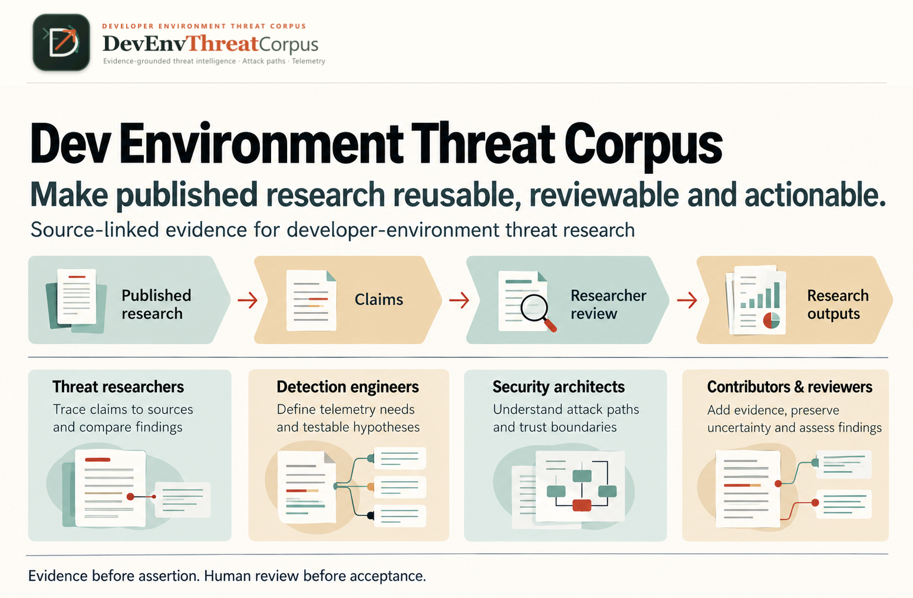

<p align="center">
  
</p>

<p align="center">
  <strong>Evidence-grounded threat intelligence · Attack paths · Telemetry</strong>
</p>

<p align="center">
  <a href=".github/LICENSE"></a>
  <a href="scripts/.node-version"></a>
  <a href="docs/status.md"></a>
  <a href="schemas/corpus.schema.json"></a>
</p>

# DevEnvThreatCorpus

DevEnvThreatCorpus is a research workbench for turning published research about
developer-environment threats into source-linked claims, inspectable attack paths
and detection hypotheses. It helps readers ask **what supports this observation,
what remains uncertain, and what would a defender need to investigate?**

> **Research preview** · Explore the workbench and its source-linked Pending draft.
> Read [coverage and review limits](docs/nx-corpus.md) before interpreting the examples.

Campaign cards put AI-role badges at top-right; **Log Collection/Telemetry Scope**
tags open supporting claims in **Security telemetry**, rather than expanding
evidence on each campaign/blog card. Research library blogs keep source-supported
tags distinct from explicitly labeled **campaign context** when a role has not
been independently extracted for that blog. Claims link back to explicitly
supported research objects.
**Prompt library** defaults to published prompt/response pairs; select **All
prompts** for prompt-only occurrences. Semgrep's refusal has one concise log-review
context summary; unknown model/role, pairing details and exact receipts remain
under **Technical provenance**. Shared reading conventions live in **Trust & method**.
No transcript is executed; scope tags do not promise available logs, and public
display does not record HITL acceptance. [Review boundaries](docs/methodology.md#enterprise-telemetry-collection-scope)
explain the terminology and remaining human decisions.

Campaign headers count linked blogs, AI tools, exact prompt variants/occurrences
and responses, supported behaviors and graph/phases. Sections follow sources,
attack flow, boxed behaviors, AI artifacts and telemetry; provenance and review
sit in a final collapsed panel. Current public JSON and ZIP share a generated
`public-research-view/1` projection (counts, defaults and explicit relationships).
The previous exact pair and restore instructions are in the
[public snapshot archive](docs/data/archive/README.md); canonical research records
and prompt-only occurrences are preserved, not replaced by a filtered display.

Research cards use the same neutral light/dark surfaces and clickable campaign,
category and publisher tags; usage and human-review labels remain explicit.
**Open campaign workspace** sits beside the campaign name. **AI tools** has one
card per existing product identity with grouped claims/research and expandable
source-local occurrence receipts, not repeated source cards or sibling-tool links.
**Security telemetry** links campaigns, blog publishers and explicitly supported
behaviors, not unrelated tools/graphs. Source/publisher filters list research
articles only; official ATT&CK/ATLAS references remain in **ATLAS & TTPs**.

### On this page

- [Vision and audiences](#vision-and-audiences)
- [Research workflow](#research-workflow)
- [What you can do](#what-you-can-do)
- [What the examples mean](#what-the-examples-mean)
- [Quickstart](#quickstart--recommended-browser-path)
- [Continue by task](#continue-by-task)
- [Validate locally](#validate-locally)
- [Contribution and review](#contribution-and-review)

## Vision and audiences

Threat researchers can follow claims back to retained source revisions.
Detection engineers can connect supported behaviors to telemetry ideas.
Security architects and platform defenders can inspect trust boundaries.
Contributors and reviewers can reproduce, correct or exclude research records
without treating a generated draft as an accepted finding.



The audience routes above and text workflow below are the complete text
alternative: make provenance, uncertainty and human review inspectable before
using campaign patterns or detection hypotheses. These are intended uses, not
proven outcomes. See [visual provenance](docs/assets/communication/vision-and-audiences.provenance.json).

## Research workflow

Private store mode also offers an explicit **Ground -> Interpret -> Relate**
manual extraction handoff. Grounded applied Pending items may supply derivation
inputs, but every claim, literal usage, behavior, occurrence, path edge and mapping
still needs its own current human approval and accepted support. Prepare each
stage from the current store, validate the returned JSON, then explicitly apply;
changed inputs require preparation again, never an automatic rebase.
See the [stage CLI and protected comparison recipes](docs/reference/cli.md#staged-extraction-and-protected-regeneration)
and [researcher evaluation/adoption guide](docs/researcher-review-guide.md#staged-extraction-and-independent-comparison).
These commands do not call a model, adopt an extraction, or replace the public
preview automatically. Native Windows remains public-preview-only.

**Published research → Source-linked claims → Researcher review and acceptance →
Campaign patterns and Detection hypotheses**

1. **Published research:** select attributable reports and record retrieval,
   revisions and retention limits. A failed collection supplies no evidence.
2. **Source-linked claims:** retain exact passage support, origins, uncertainty
   and contradictions. Manual or researcher-mediated AI output remains a draft.
3. **Researcher review and acceptance:** inspect that support and record explicit
   human decisions. Changed supporting content can make earlier acceptance stale;
   local reviewer identity is self-attested, not authenticated.
4. **Campaign patterns:** inspect supported within-case paths before comparing
   cases. Grouping records creates neither chronology nor causal relationships.
5. **Detection hypotheses:** relate observations to possible telemetry and
   detection ideas. A mapping or hypothesis is not an evaluated detection rule.

See the [research workflow](docs/workflow.md) for stage inputs, actions, outputs
and limits; the process does not imply completed research acceptance.

<a id="current-implementation"></a>
## What you can do

- Explore case and research libraries, claims, exact revision citations, conflicts
  and typed timelines in the browser-based **Research Workbench**.
- Inspect attack paths, behaviors, AI tools, prompt artifacts, framework
  candidates and telemetry proposals without merging their evidence or review states.
- Deliberately collect authorized public HTTPS sources into a private store, or
  supply text/files; collection is not claim acceptance.
- Draft claims manually or use an explicit request/chat/candidate handoff.
  That remains the default. An [optional CLI-only OpenAI adapter](docs/reference/cli.md#optional-openai-generation)
  can generate a protected untrusted candidate from operator-confirmed public
  research; it is disabled by default and never applies or approves output.
- Record local item-level human decisions and produce reproducible reviewed/draft
  exports with read-only queries, subject to current eligibility checks.

### Campaign categories and framework references

Campaign cards show overlapping high-level **Victim-side agent abuse**,
**Attacker-side AI use**, **AI review targeting**, and **Developer-targeted social
engineering** categories when supported. Expand **Category evidence & review**
for source-local claim links; use the **Campaign categories** facet to filter.
Conservative deterministic rules propose Pending labels during claim application;
absence of a match is unclassified, never "no AI". Nx currently has four
source-local proposals for victim-side agent abuse, shown as one campaign badge.
These are research labels, not official MITRE technique IDs or success findings.

**ATLAS & TTPs → Mapping and catalog coverage** includes a searchable offline
ATT&CK Enterprise 19.2 reference: **697 active techniques/subtechniques** from the
existing immutable pin, rather than the earlier T1059-only projection. Revoked
and deprecated entries are inventoried but excluded. Current reference expansion
does not add incident mappings or rewrite historical extraction snapshots.
The catalogue asset and frozen historical request fixture have scoped LF checkout
rules in `src/.gitattributes` and `tests/fixtures/benign/.gitattributes`, so Windows
Git newline conversion does not change their reproducible bytes.

### Private local review

Start `node scripts/server.mjs --store /absolute/private/store` on POSIX (store
directory `0700`, `corpus.json` `0600`; inside this clone use ignored
`.private-intake/`). Open **Review**: campaign categories, grounded AI/coding tools,
behaviors/occurrences and prompt literals are the first-class category queues; blog grouping remains
available over the same stable items/decisions. Claims are supporting evidence,
accessible separately with exceptions and later-pass records, never deleted.
Set your self-attested identity once per tab/session, visibly editable (not
authenticated). Use the [researcher-review/3 guide](docs/researcher-review-guide.md):
read the compact candidate, evidence/citation and category checklist, then choose
**Accept item — I confirm** as one explicit personal attestation. Review each
required support item separately; accepting a candidate never approves a claim.
Modify never accepts; Exclude retains provenance/history; Unsure records a reason,
while Next item only navigates. Navigation/filter selection resumes in this browser.
Modify exposes prefilled friendly fields, not JSON; Save changes is separate from
Accept. Reject has canonical reason choices; only Other needs extra prose. After
deciding, confirmation and previous/history access remain while the queue advances.
Advanced mapping/path/proposal UX is deferred, not approved: these records stay
Pending/withheld unless independently reviewed. N/A labels are outside label
denominators; priority counts disclose hidden evidence/deferred records.
Support review restores the original workload, category, grouping, source and
filter rather than leaving the advanced queue active. Current exclusions show
**Human-reviewed · Excluded**, distinct from acceptance and stale review. Identical
exact passages are displayed once with their separate provenance links retained.
Human-edited tool display identities are shared by Review, library and campaign/blog
cards; literal source values stay visible and corrected identities do not silently
merge products. See the [AC evidence ledger](docs/acceptance-audit.md#issue-81-local-hitl-review)
for deferred coverage and the independent human decisions still required.

To try review without a private store, open **Review → Start synthetic review
exercise (isolated, not Nx)**. It loads benign tool, behavior/occurrence, prompt
and supporting-claim fixtures into server memory. Exercise support review, edits,
accept/reject/unsure, category/blog grouping, reload and history. Browser reload
retains this session; server restart resets it. It never writes the public Nx
draft, a read-only corpus or a private store. **Load synthetic demo** remains the
older inspect-only example; **Reload local corpus** refreshes the selected review
exercise while it is active, not an implicit switch to private data.

Claims, behavior definitions/occurrences, annotations (including prompt/tool usage),
categories, timelines, summaries, path nodes/edges, mappings and proposals require
their own approval. Supporting changes block affected approvals without approving
anything downstream. Content origin, label authorship and human review are shown
separately. Cards show denominators for extraction, populated labels, current
human review and eligibility—not a quality score.

**Compatibility:** `--profile reviewed` now requires current item-level HITL
acceptance for every reviewable record; legacy `manual-review/1` claim acceptance
and pending optional enrichment no longer qualify. Re-review through this page.
`GET /api/review/export` downloads a reviewed JSON projection including accepted
private sidecar annotation metadata; CLI `review.mjs status` adds `itemReview`,
and `decide` also accepts item templates using its snapshot and guide version.
File-based CLI exports cannot discover sidecars and withhold those annotations.
Reviewed outputs omit article bodies, passage quotations and annotation content;
minimal case identity context can accompany an accepted claim without approving
or exposing the unreviewed summary; context rows have `contextOnly: true` and no
acceptance. Generated profile schema covers accepted optional/nested units.
they are projections, not importable private audit backups. Existing draft and
private campaign/talk exports keep their explicit private-draft semantics.
No button publishes or mutates the bundled Nx/s1ngularity preview snapshot.
Independent human semantic, UX/accessibility and documentation review is still
required before merge; this feature does not establish campaign acceptance.

<a id="project-status-and-next-work"></a>
## What the examples mean

This is an **early research workbench**, not a deployed processing service or an
independently validated incident corpus. Implemented validation, review and export
mechanisms do not establish research truth or evaluated extraction quality.

The bundled **Nx / s1ngularity public Pending draft** is an inspectable example,
not a reviewed release or semantic gold. Its original baseline contained 38 claims,
14 behaviors, three representative phase paths and two Proposed mappings.
The expanded preview adds source-local Pending extraction from Semgrep
and Panther plus precise StepSecurity targets and conditions, across six parsed
reports. Publisher article cards stay separate within one Nx campaign. The
current extraction totals 97 Pending claims; complete parsing does not establish
exhaustive semantic extraction or completed HITL. Full articles,
other quotations and private run bundles are withheld;
the published prompt literals are source-attributed, untrusted research artifacts.
See [coverage, omissions and review limits](docs/nx-corpus.md) and its
[typed draft export](docs/data/nx-draft.zip).

The **synthetic demos and offline fixtures are synthetic**, not incident evidence.
Test success, catalog membership and attractive diagrams cannot promote their
claims. Research, accessibility and editorial acceptance still require independent
human review; see the [evidence ledger](docs/acceptance-audit.md).

## Quickstart — recommended browser path

[](https://codespaces.new/ashwin-patil/DevEnvThreatCorpus)

[Create a GitHub Codespace for DevEnvThreatCorpus](https://codespaces.new/ashwin-patil/DevEnvThreatCorpus).
No local clone or installation is required for this path.

1. Follow the link, **sign in to GitHub**, select the supported default branch
   **`main`**, and confirm creation. The link opens GitHub's creation flow; it
   does not bypass confirmation or promise instant provisioning.
2. Wait for the existing devcontainer setup/start tasks. They provision Python
   3.12 and the pinned Node runtime, then automatically start the workbench.
   Initial creation/rebuild needs network access for image and package downloads.
3. Open **Research Workbench (private)**, or **Ports → 4173 → Open in Browser**
   if a tab does not open. Use an external browser tab, not an embedded preview.
4. Start with the public Pending draft. For a benign exercise choose **Load
   synthetic demo**, or **Load synthetic research demo** in a research view.
   The inspect-only demos do not populate a store. For writable benign review,
   choose **Review → Start synthetic review exercise (isolated, not Nx)**.

The workbench starts in **light mode** on a first visit, even if your system
prefers dark mode. Use the compact **sun/moon toggle** in the header to switch
themes (accessible name: **Dark mode**). The selected icon is outlined. Your explicit
choice is remembered for that browser origin across reloads; it does not alter
corpus records or reset research state. If browser storage is unavailable, a
header notice explains that the choice cannot be restored or saved, and the
toggle still works for the current page.

Keep port `4173` **Private**. Do not publish the port or use public tunnels.
Before private research, verify signed-in access and signed-out denial; a port
label or local readiness check does not establish access control.

[Getting started](docs/getting-started.md) explains the first inspection and local
alternative. The [Codespaces guide](docs/guides/codespaces.md) covers stop/restart,
rebuild, troubleshooting, private stores and quota/billing. Stop the Codespace
when finished: closing a browser tab alone does not immediately stop compute.

### Local alternative

On a POSIX environment with the exact [pinned Node version](scripts/.node-version)
(`22.23.3`), run from your clone:

```sh
cd /absolute/path/to/DevEnvThreatCorpus
node "$PWD/scripts/server.mjs"
```

Open `http://127.0.0.1:4173/`; stop with Ctrl+C. No application install/build,
model, CDN or network connection is needed for this preview after obtaining the
repository and runtime.

For the **public preview on native Windows**, use the same pinned Node runtime
and run `node .\scripts\server.mjs` from PowerShell in your clone. The public
draft and synthetic demos do not need private filesystem permissions.
Native Windows `--corpus` and `--store` server modes are explicitly unsupported;
private collection, review and file-based exports remain POSIX-only. For those
operations, use Codespaces or WSL2 with the clone and store in the Linux
filesystem, not under `/mnt/c`. Windows verification reports these private-store
and Linux lifecycle tests as skipped, not passed.
See [local setup and data modes](docs/getting-started.md#local-alternative).

## Continue by task

The [architecture overview](docs/architecture.md) explains components and trust
boundaries. Current technical references cover the [data model](docs/reference/data-model.md),
[CLI](docs/reference/cli.md), [formats/versioning](docs/reference/formats-and-versioning.md)
and [runtime configuration](docs/reference/configuration.md).
The links below retain earlier README destinations and lead to current contracts
and benign executable recipes, not historical test evidence.

<a id="github-codespaces-automatic-research-workbench"></a>
- **Codespaces:** [creation and lifecycle](docs/guides/codespaces.md),
  [private access](docs/guides/codespaces.md#private-port-and-access-checks) and
  [opt-in private stores](docs/guides/codespaces.md#opt-in-private-store).
<a id="research-workbench-offline-preview"></a>
- **Workbench preview:** [first inspection](docs/getting-started.md#inspect-the-workbench)
  and [local data modes](docs/getting-started.md#local-data-modes).
<a id="manual-intake-offline-exercise"></a>
- **Manual intake:** [source, retrieval and failure contract](docs/architecture.md#manual-intake-contract); [offline exercise](docs/reference/cli.md#offline-exercise-setup).
<a id="batch-campaign-collection-cli-and-local-web"></a>
- **Batch collection:** [private archives, bounds and recovery](docs/architecture.md#batch-collection-and-private-archives); [authorized command usage](docs/reference/cli.md#batch-collection).
<a id="research-views-and-talk-preparation"></a>
- **Research views and talk preparation:** [presentation and private annotations](docs/architecture.md#optional-research-presentation-and-private-annotations).
<a id="private-talk-enrichment"></a>
- **Private enrichment:** [templates, validation and Pending annotations](docs/architecture.md#private-talk-enrichment-contract); [offline exercise](docs/reference/cli.md#private-enrichment).
<a id="campaign-extraction-through-a-configured-codex-chat"></a>
- **Campaign chat handoff:** [prepare/validate/apply/status/export and limitations](docs/architecture.md#campaign-extraction-contract); [offline plumbing and manual handoff](docs/reference/cli.md#campaign-requestchatcandidate-handoff).
<a id="manual-extraction-offline-exercise"></a>
- **Manual extraction:** [exact passages and Pending-only results](docs/architecture.md#manual-extraction-contract); [offline exercise](docs/reference/cli.md#manual-extraction).
<a id="manual-claim-review-offline-exercise"></a>
- **Human claim review:** [decisions, staleness and failure codes](docs/architecture.md#manual-claim-review-contract); [synthetic exercise and human decision procedure](docs/reference/cli.md#manual-claim-review).
<a id="corpus-exports-and-read-only-queries-offline-exercise"></a>
- **Exports and queries:** [profiles, dependency closure and reproducibility](docs/architecture.md#reproducible-exports-and-read-only-queries); [offline exercise](docs/reference/cli.md#exports-and-read-only-queries).
<a id="comparison--timelines-filter-collected-observations"></a>
- **Comparison and timelines:** [filters, typed dates and count semantics](docs/architecture.md#comparison-and-typed-timeline-model).
<a id="curator-studio-paste-select-draft-download"></a>
- **Curator studio:** [paste/select/draft/download and proposal boundaries](docs/architecture.md#studio-boundary-and-proposal-formats).

Private retained text, candidates, decisions and exports must stay private.
Use ignored `.private-intake/` directories with mode `0700` and files `0600`
inside a clone; ignoring a path is not access control or a backup.
Never commit private bundles/screenshots, credentials or credential-bearing URLs.
Source text, code and prompts are untrusted research data, never instructions to execute.

## Validate locally

For contributors, use Python 3.12 with the pinned governance dependency and the
pinned Node runtime, from the repository root:

```sh
python -m pip install --requirement requirements-governance.txt
npm ci --prefix scripts --ignore-scripts
python scripts/verify.py
```

The verifier runs scaffold checks and the eight application commands in
[`project.config.json`](project.config.json). Synthetic/offline checks are not
live Codespaces, real-extraction quality or independent research acceptance.
See [setup and verification](docs/setup-and-configuration.md).

Campaign preparation uses versioned context-aware chunks with a locked, locally
bundled `o200k_base` reference tokenizer: at most 2,000 tokens including up to 200
tokens of overlap, with canonical revision offsets and explicit split warnings.
This is not a model-context guarantee or evidence of extraction accuracy.
After installing the locked dependency, inspect a benign report with
`node .\scripts\extract.mjs campaign report-demo` (also supported on Windows).
For private source reports, use the POSIX-only
[campaign report command](docs/reference/cli.md#campaign-requestchatcandidate-handoff).
Report metadata is deterministic before and after saving/reloading a request.
Regeneration must use the new request's segment IDs; changing an old candidate's
request hash alone does not convert its coverage or quotations.
See the [chunk-policy and historical compatibility contract](docs/reference/formats-and-versioning.md#context-chunking-core-checkpoint-84).

## Contribution and review

Start with a complete scoped implementation issue and stable acceptance IDs.
An authorized human starts the work; corrections stay on the originating PR,
and an independent human must approve before merge.
Follow [contribution guidance](.github/CONTRIBUTING.md),
[documentation upkeep](docs/setup-and-configuration.md#documentation-upkeep-policy)
and the [community standards](.github/CODE_OF_CONDUCT.md).
Report vulnerabilities through [SECURITY.md](.github/SECURITY.md), not public research records.

The [documentation index](docs/README.md) links technical and governance detail.
Superseded planning documents and historical design/evidence assets are reached
through the [history index](docs/archive/README.md#planning-and-asset-relocation--issue-77),
with immutable preservation links rather than current operating instructions.
The [historical handoff](https://github.com/ashwin-patil/DevEnvThreatCorpus/blob/a29de1822513b77d15b6fcf1c88dff147bf6140c/handoff/00-START-HERE.md)
records proposals and design history, not a list of shipped features. Its public
archive retains a full repository snapshot, not just the handoff directory;
[preservation evidence and historical limitations](docs/archive/README.md#handoff-relocation--issue-73)
explain the authorized relocation out of the current tree.
Its [archival prerequisite](docs/setup-and-configuration.md#historical-handoff-archival-authorization--issue-75)
classifies the existing historical paths for a separately reviewed cleanup;
the authorization and subsequent relocation change no runtime behavior and do not
erase public history or resolve outstanding redistribution/rights questions.
