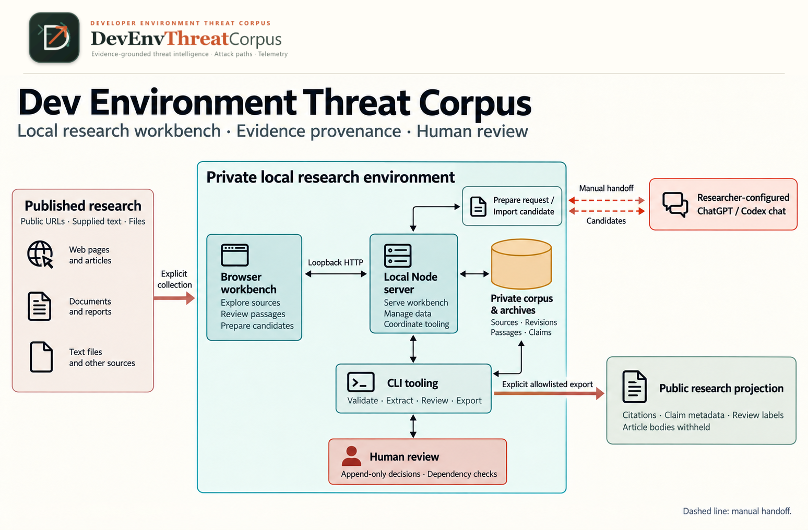

# System architecture

DevEnvThreatCorpus is an operator-driven research workbench:
**published research → source-linked claims → researcher review and acceptance →
campaign patterns and detection hypotheses**. Collection, drafting, review and
export are separate actions. No runtime model, database, queue, hosted review
service or automatic acceptance is configured.

## Components and responsibilities

| Component | Responsibility and implementation |
|---|---|
| Browser workbench | Vanilla local HTML/CSS/ES modules: [app](../src/app.mjs), [model](../src/model.mjs), [rendering](../src/render.mjs), [exploration](../src/explore.mjs). Displays sources, claims, conflicts, paths, typed timelines and proposals; imported text is inert |
| Loopback Node server | [server.mjs](../scripts/server.mjs) serves allowlisted assets and bounded APIs at `127.0.0.1:4173`; explicit store mode enables collection and campaign handoff, not arbitrary filesystem access |
| Contract and intake tooling | [contract.mjs](../scripts/contract.mjs) owns validation, canonical identity/hashes, private persistence, single/batch intake, reviewed/draft exports and queries. Server and CLI share helpers; the server need not spawn a CLI process |
| Extraction tooling | [extract.mjs](../scripts/extract.mjs) applies manual templates and exposes enrichment/campaign commands; [campaign.mjs](../src/campaign.mjs) binds requests, validates untrusted candidates and applies Pending records |
| Human review tooling | [review.mjs](../scripts/review.mjs) records explicit local claim decisions and reports current eligibility; identity is self-attested |
| Private storage | Protected `corpus.json`, article archives, annotation sidecars and operator-held request/candidate/decision/export files. Immutable campaign run snapshots live inside corpus governance, not a database |
| Public views | The bundled [Nx draft projection](../src/data/nx-draft.json), explicit synthetic demos and separately generated profile exports have different withholding/review semantics; none is the private archive |

## Data flow and implementation boundary

1. A researcher deliberately supplies authorized text/files or selects public HTTPS
   URLs. Intake records source identity, exact retained revisions, hashes, parser
   versions and collection outcomes. Batch collection associates successful sources
   with an explicit existing case or new Pending campaign; failures remain failures.
2. Manual extraction uses an explicit existing case and exact revision passages.
   Alternatively, campaign preparation freezes retained input and a versioned
   prompt into a **private request**. The researcher transfers it to their configured
   chat and returns a **private candidate**. Local validation and explicit apply
   check scope, freshness, coverage, exact quotations and dependency closure.
   No repository code contacts a model provider, discovers credentials or silently
   refetches missing text.
3. Claims and optional derived records remain Pending. A human inspects wording,
   evidence, inference and conflicts before recording claim decisions.
   Acceptance depends on the whole current non-review corpus base as well as
   entity/dependency hashes; a later content edit can stale earlier decisions.
4. Browser projections inspect these records without accepting them. Graph layout,
   article/product/prompt grouping and comparison facets are presentation only.
   They create neither evidence, chronology, attribution nor shared review status.
5. Explicit exports select reviewed or draft material and close dependencies.
   Core profile exports strip full article bodies but can retain passage excerpts.
   Campaign talk bundles can contain raw HTML text and normalized private bodies
   and must stay private; separately archived files are not copied into them.
   Neither an export command nor this diagram authorizes public redistribution.

## Trust boundaries

- **External content → intake:** credential-free public HTTPS only, address and
  redirect checks, DNS pinning, TLS/peer verification, robots policy and finite
  budgets. Access denial is not permission to bypass a site. Supplied-text
  fallback is allowed only with independent authorization to supply and retain it.
- **Private files → local server/browser:** restrictive filesystem permissions,
  validation, exact asset/artifact allowlists, loopback Host/Origin/Fetch-Metadata
  checks and CSP. Original HTML is download-only, never rendered in the application.
  Local users can see private text; do not deploy or publicly tunnel this server.
  Codespaces forwarding must remain Private and needs independent access checks.
- **Retained text → claims:** exact Unicode code-point passage support is checked
  against the named normalized revision, not the current live page. Correspondence
  is not incident truth. Inferences have explicit rationale and supporting claims.
- **Chat/browser draft → canonical corpus:** candidates and proposals are untrusted
  data. Validation is not semantic approval; imports cannot create human acceptance.
  The richer studio proposal is not a replacement corpus or automatic merge format.
- **Recorded decision → eligible acceptance:** hashes and append-only application
  rules do not authenticate a reviewer or make filesystem storage tamper-proof.
  Review status, evidence status and authorship origin stay independent.
- **Private corpus → output:** withholding and profile closure are explicit.
  Review eligibility is not copyright clearance, and draft/synthetic outputs are
  not accepted research or evaluated detection rules.

The component table and numbered flow are the complete text alternative.
The storage symbol means **private files and archives**, not a database dependency.
Server/CLI arrows describe shared tooling and data flow, **not guaranteed subprocess
calls**. Chat handoff crosses an explicit researcher-controlled external boundary;
it is not a runtime model integration. Public projections are narrower views,
not copies of private storage or evidence of research acceptance.
The supplied image bytes/logo are unchanged; see
[asset provenance](assets/communication/system-architecture.provenance.json).

## Authoritative technical references

| Topic | Current authority |
|---|---|
| Core entities, support, status axes and derived presentation | [Data model](reference/data-model.md) |
| Commands, benign executable exercises, errors and recovery | [CLI](reference/cli.md) |
| Schema/type ownership, wire formats, version identities, framework pins, export contracts | [Formats and versioning](reference/formats-and-versioning.md) |
| Startup modes, local APIs, private storage and finite bounds | [Configuration](reference/configuration.md) |
| Research interpretation and maturity | [Methodology](methodology.md), [workflow](workflow.md), [status](status.md) |
| Environment lifecycle and governance policy | [Codespaces guide](guides/codespaces.md), [setup and configuration](setup-and-configuration.md) |

The JSON Schema, TypeScript declarations and runtime validators remain the
implementation authorities; these references explain them, not replace them.

## Decision

The current `0.3.0` corpus starts from newly supplied sources. Frozen `0.2.0`
material in `handoff/reference/` is historical, not an input dataset, migration
seed or compatibility target. The older migration proposal remains preserved,
not revived by the workbench's adapted presentation.

## Current implementation

Default startup has an empty local corpus API but the **browser displays the
bundled public Pending Nx draft**, not an empty screen. Explicit synthetic demos
are separate. `--corpus` is a validated read-only startup snapshot; `--store`
enables dynamic private data and bounded collection/campaign writes. Both
batch collection and reproducible profile exports are implemented.
There is no application install/build step, model adapter or automatic review.
See [configuration](reference/configuration.md#startup-modes).

## Preserved technical entrypoints

These existing headings remain usable for inbound links. Detailed contracts now
have the single authoritative homes below; dated evidence is not current test proof.

## Issue #51 campaign presentation and article identity

See [presentation-only grouping](reference/data-model.md#presentation-only-grouping).

### ATLAS catalog and compact evidence presentation

See [pinned framework references](reference/formats-and-versioning.md#pinned-framework-references).

### Campaign AI artifacts

See [literal artifacts and grouping](reference/data-model.md#presentation-only-grouping).

## Optional research presentation and private annotations

See [optional derived records](reference/data-model.md#optional-derived-records)
and [private enrichment](reference/formats-and-versioning.md#private-enrichment).

## Local Research Workbench and private curator studio

See [startup modes](reference/configuration.md#startup-modes) and
[curator studio](reference/cli.md#curator-studio).

### Comparison and typed timeline model

See [dates and comparison](reference/data-model.md#dates-and-comparison).

### Studio boundary and proposal formats

See [studio proposals](reference/formats-and-versioning.md#studio-proposals).

## Manual intake contract

See [intake commands](reference/cli.md#manual-intake).

### Records, identity, and provenance

See [core entities](reference/data-model.md#core-entities) and
[identity and normalization](reference/formats-and-versioning.md#identity-and-normalization).

### Retrieval trust boundary and finite bounds

See [retrieval and bounds](reference/configuration.md#retrieval-and-bounds).

### Deterministic readable text

See [identity and normalization](reference/formats-and-versioning.md#identity-and-normalization).

### Private persistence and recovery

See [private persistence](reference/configuration.md#private-persistence) and
[recovery](reference/cli.md#errors-and-recovery).

### Evidence and remaining limitations

See [preserved evidence and handoff](#preserved-evidence-and-handoff).

## Manual extraction contract

See [manual extraction](reference/cli.md#manual-extraction) and
[exact passage support](reference/data-model.md#exact-passage-support).

## Manual claim review contract

See [review commands](reference/cli.md#manual-claim-review).

### Correction and append-only audit

See [review decisions](reference/formats-and-versioning.md#review-decisions).

### Current eligibility and status axes

See [review freshness](reference/data-model.md#review-freshness-and-status-axes).

### Failures and trust boundary

See [errors and recovery](reference/cli.md#errors-and-recovery).

## Batch collection and private archives

See [batch commands](reference/cli.md#batch-collection) and
[archive format](reference/formats-and-versioning.md#private-archives).

## Private talk enrichment contract

See [enrichment commands](reference/cli.md#private-enrichment) and
[enrichment format](reference/formats-and-versioning.md#private-enrichment).

## Campaign extraction contract

See [manual chat handoff](reference/cli.md#campaign-requestchatcandidate-handoff)
and [campaign formats](reference/formats-and-versioning.md#campaign-handoff-and-runs).

## Reproducible exports and read-only queries

See [exports and queries](reference/cli.md#exports-and-read-only-queries) and
[profile contracts](reference/formats-and-versioning.md#profile-exports).

## Preserved evidence and handoff

Historical acceptance IDs, tables, dated observations and limitations from the
replaced sections remain in the
[pre-split architecture at merged PR #67](https://github.com/ashwin-patil/DevEnvThreatCorpus/blob/a741924a776bff0a0ea17b7920a7282320d2caaf/docs/architecture.md).
In particular, preserve its [#31 AC-01–AC-04 table](https://github.com/ashwin-patil/DevEnvThreatCorpus/blob/a741924a776bff0a0ea17b7920a7282320d2caaf/docs/architecture.md#studio-boundary-and-proposal-formats)
and [#30 AC-01–AC-03 mapping](https://github.com/ashwin-patil/DevEnvThreatCorpus/blob/a741924a776bff0a0ea17b7920a7282320d2caaf/docs/architecture.md#retrieval-trust-boundary-and-finite-bounds).
The existing [acceptance audit](acceptance-audit.md) retains the #8, #12, #21,
#24, #25, #39, #45, #46 and #51 evidence records.
[Task #63](https://github.com/ashwin-patil/DevEnvThreatCorpus/issues/63) owns
evidence/session-note archive navigation and cleanup; this split does not rewrite
acceptance history. Current #62 command results and AC-01–AC-08 review handoff
belong on [PR #68](https://github.com/ashwin-patil/DevEnvThreatCorpus/pull/68),
not in the technical contracts. Independent technical, editorial, accessibility,
rendered-document and README-relevance review remain required before human merge.
