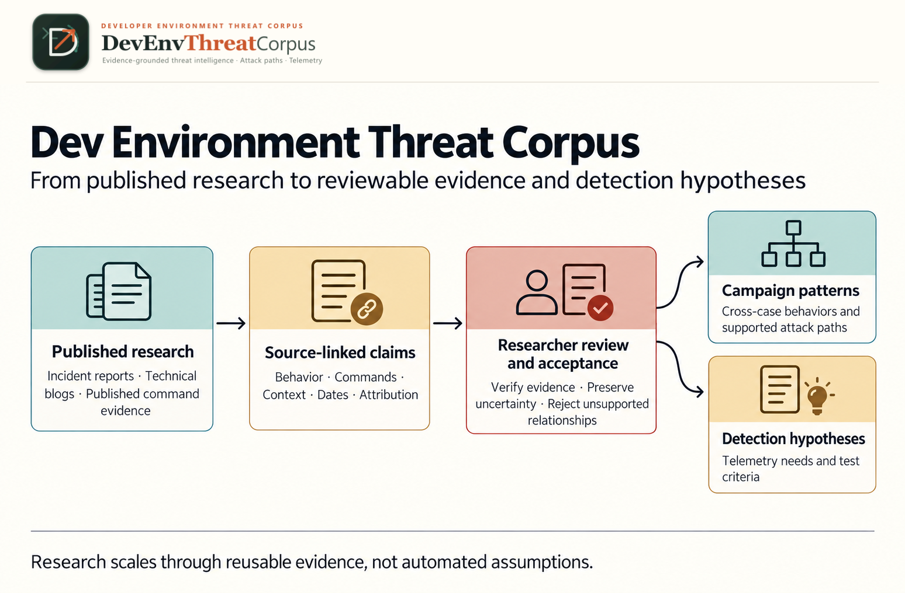

# Research workflow

**Published research → Source-linked claims → Researcher review and acceptance →
Campaign patterns and Detection hypotheses**

These are five research stages, not an automatic processing or approval pipeline.
The [getting-started guide](getting-started.md) provides the first-use route;
[methodology](methodology.md) defines evidence and review terminology, and
[status](status.md) separates implemented mechanisms from evaluated outcomes.
The [architecture overview](architecture.md) explains component responsibilities
and trust boundaries; its linked technical references own detailed contracts.

The five sections below are the complete text alternative: each describes inputs,
researcher action, outputs, uncertainty and the acceptance boundary. Collection
does not accept claims; changed evidence can stale review; campaign patterns need
supported relationships, and detection hypotheses remain unevaluated until tested.
The image depicts the intended process, not completed research acceptance.
See [visual provenance](assets/communication/research-pipeline.provenance.json).

## 1. Published research

- **Inputs:** explicit reports the researcher is authorized to collect and retain,
  or authorized supplied text/files; source attribution and collection scope.
- **Researcher action:** select relevant sources, check access/retention rights,
  collect deliberately into a private store, and inspect success/failure records.
  Keep source identity separate from each retained revision, its raw/normalized
  hashes and parser/normalization versions.
- **Output:** sources, retained revisions and collection manifests; batch mode can
  also retain protected originals and image metadata. Failed attempts remain
  failures, with no invented body, hash, claim or successful coverage.
- **Uncertainty:** retrieval is not publication or activity time; normalization can
  lose presentation context. Supplied URL association is an operator assertion,
  not authenticated article identity. A later live page may differ from a revision.
- **Acceptance boundary:** collection establishes available input, not research
  truth, case membership, claim acceptance or permission to redistribute it.
  Never bypass access restrictions; use supplied material only when authorized.
- **References:** [intake and provenance](architecture.md#manual-intake-contract),
  [batch/private archives](architecture.md#batch-collection-and-private-archives),
  [private-store setup](guides/codespaces.md#opt-in-private-store).

## 2. Source-linked claims

- **Inputs:** an explicitly selected case, retained source revisions and exact
  normalized text; researcher-authored templates or an explicit campaign request.
- **Researcher action:** select passages and write source-local claims manually,
  or prepare a request, hand it to a configured chat, then validate and apply the
  returned untrusted candidate. Preserve skipped/failed segments and limitations.
  Inspect both wording and support rather than accepting a plausible paraphrase.
- **Output:** Pending claims with source/revision/passage links, evidence status,
  origin, uncertainty, and reciprocal conflicts where applicable. Inferences
  instead carry explicit supporting claims and rationale. Campaign extraction
  may additionally produce Pending annotations and optional research records.
- **Uncertainty:** an exact text match proves correspondence to retained input,
  not the reported event. AI output may omit, overstate or misclassify material;
  segment completion is not semantic completeness. Distinct reports can disagree.
- **Acceptance boundary:** neither template validation nor candidate application
  approves research. No runtime model/provider is called by the repository.
  Read the [public-safe Nx example](methodology.md#public-safe-nx-worked-example)
  without reconstructing its withheld quotations.
- **References:** [manual extraction](architecture.md#manual-extraction-contract),
  [researcher-mediated campaign handoff](architecture.md#campaign-extraction-contract).

## 3. Researcher review and acceptance

- **Inputs:** Pending claims, exact retained support, inference/conflict context
  and the current review-base digest, plus an explicit private human decision.
- **Researcher action:** inspect meaning, evidence, scope and uncertainty; accept,
  request a correction, or exclude with a rationale. Inspect current status again
  after any non-review corpus edit. Review contradictions rather than hiding them.
- **Output:** append-only local decision events and recorded/effective status.
  Correction changes a permitted claim revision to `Needs correction`; it needs
  a separate acceptance. Exclusion retains the record and decision history.
- **Uncertainty:** reviewer identifiers are self-attested, not authenticated.
  Append-only enforcement is an application invariant, not tamper-proof storage.
  Recorded UI events alone do not establish current cryptographic eligibility.
- **Acceptance boundary:** only explicit eligible human decisions count for the
  reviewed export profile. Any non-review base change can stale acceptance,
  even outside the selected claim. A case marked `Reviewed` does not mean every
  claim is accepted. Independent research/editorial approval is not supplied by
  agent self-audit, validation or a green test run.
- **References:** [review/correction contract](architecture.md#manual-claim-review-contract),
  [current eligibility](architecture.md#current-eligibility-and-status-axes),
  [reviewed versus draft exports](architecture.md#reproducible-exports-and-read-only-queries).

## 4. Campaign patterns

- **Inputs:** case-scoped claims, uncertainty/conflicts, supported behaviors and
  optional path nodes/edges, plus typed source/activity dates and review state.
- **Researcher action:** first reconstruct only supported relationships within
  each case; keep inferred relationships distinct and disconnected nodes when
  support is missing. Then compare cases using explicit facets, definitions and
  evidence boundaries, retaining each member's provenance and review state.
- **Output:** inspectable within-case paths, unordered behavior sets where sequence
  is unknown, and cross-case comparison questions or candidate patterns.
  Display grouping is not a persistent accepted synthesis.
- **Uncertainty:** shared behaviors, tools, citations or campaign tags do not prove
  shared actors, causal relationships, prevalence or one campaign. Overlapping
  date bounds do not establish order; publication/retrieval dates are not activity
  dates. Missing paths or records do not prove a behavior did not occur.
- **Acceptance boundary:** graph layout, source associations and facet counts
  cannot manufacture chronology or acceptance. Cross-case patterns require human
  synthesis with explicit support; the Nx graph is a single Pending case, not
  independently validated cross-case research.
- **References:** [typed comparison/timelines](architecture.md#comparison-and-typed-timeline-model),
  [path and support presentation](architecture.md#optional-research-presentation-and-private-annotations),
  [Nx reconstruction limits](nx-corpus.md#interpretation-and-public-boundary).

## 5. Detection hypotheses

- **Inputs:** supported behavior/relationship claims, environment assumptions,
  published guidance, and explicit proposed telemetry or framework mappings.
- **Researcher action:** distinguish source-mentioned guidance from researcher
  proposals, identify observable signals and blind spots, and state what a future
  evaluation would need. Keep framework membership separate from applicability.
- **Output:** claim-linked hypotheses, Proposed mappings, telemetry ideas and
  optionally explicitly labeled inert synthetic OTEL samples.
- **Uncertainty:** available telemetry, collection settings, false positives,
  evasion and deployment context remain unmeasured unless independently evaluated.
  A catalog match only resolves an identifier; synthetic samples are not incidents.
- **Acceptance boundary:** a hypothesis is not an implemented or evaluated rule.
  This task implements no rule and claims no detection effectiveness. Absence of
  hypotheses in the Nx example is not absence of the underlying record mechanism.
- **References:** [campaign records and mapping boundaries](architecture.md#campaign-extraction-contract),
  [private enrichment](architecture.md#private-talk-enrichment-contract),
  [capability/evaluation matrix](status.md#capability-and-maturity-matrix).

## Review of this documentation

Historical [documentation review evidence](https://github.com/ashwin-patil/DevEnvThreatCorpus/blob/a29de1822513b77d15b6fcf1c88dff147bf6140c/docs/development/documentation-review-evidence.md#issue-61-acceptance-evidence)
is retained separately from the research workflow.
